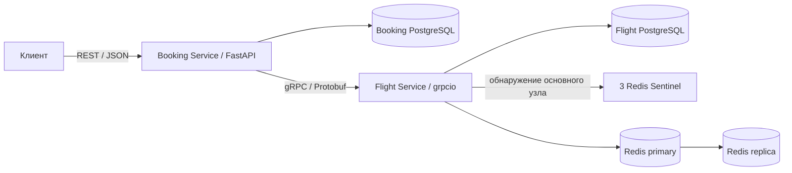
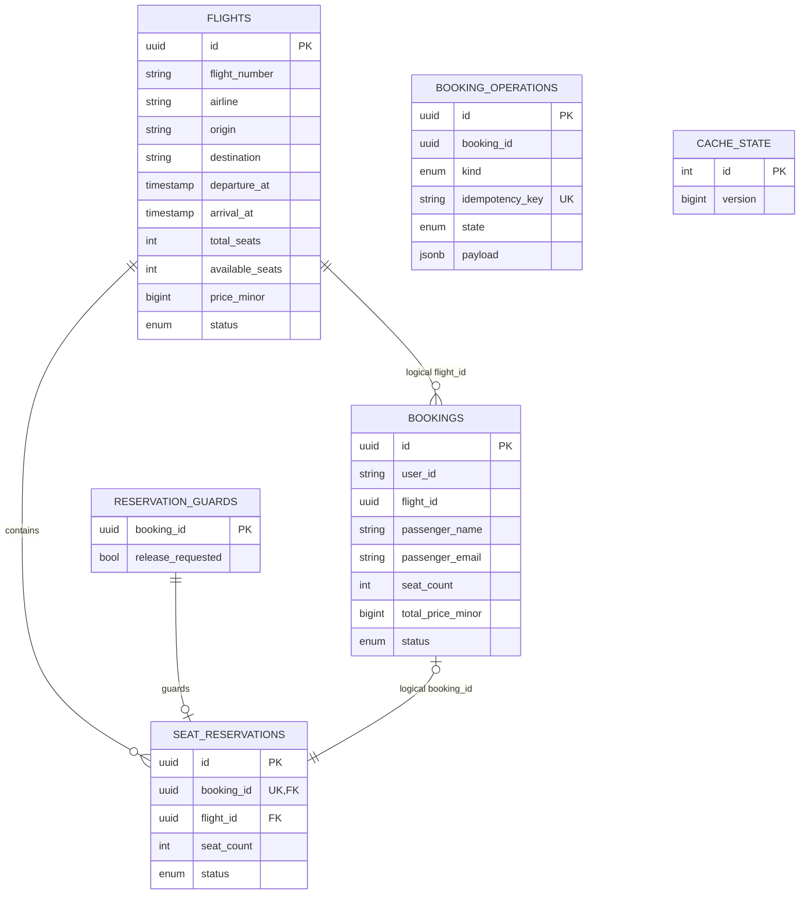

## 1. Согласованные решения

- Python, FastAPI, grpcio с кодогенерацией Protobuf.
- Два сервиса, у каждого собственный PostgreSQL.
- Booking Service принимает REST-запросы и вызывает Flight Service по gRPC.
- Saga с оркестрацией в Booking Service: журнал операций в его БД и восстановление внутри того же приложения.
- Redis: основной узел, реплика и три Sentinel.
- Cache-Aside с общей версией кеша в Flight PostgreSQL.
- Запуск всей системы одной командой `docker-compose up --build`.

Допущения проекта: одна валюта RUB, деньги в целых копейках, UUID для идентификаторов бронирований и рейсов, UTC для времени и даты поиска. `user_id` — непрозрачная строка; отдельный сервис пользователей не нужен. Цена фиксируется по ответу GetFlight и сохраняется в операции до резервирования.

## 2. Компоненты и инструменты



Booking Service отвечает за бронирования и координацию их создания/отмены. Flight Service отвечает за рейсы, остатки мест, резервации и кеш. Доступ к чужой БД запрещён.

Используемые библиотеки:

| Назначение | Инструмент |
|---|---|
| REST и валидация | FastAPI, Pydantic, Uvicorn |
| gRPC и кодогенерация | grpcio, grpcio-tools, protobuf |
| PostgreSQL | SQLAlchemy 2, psycopg 3 |
| Миграции | Alembic |
| Redis Sentinel | redis-py |
| Проверки | pytest, HTTP-клиент для интеграционных сценариев |

Реализована синхронная работа: обычные `def`-обработчики FastAPI, gRPC-сервер с пулом потоков, синхронные SQLAlchemy и redis-py. Сетевые операции и блокировки имеют таймауты. Сессии SQLAlchemy не разделяются между потоками. Версии зависимостей зафиксированы в requirements.lock.

Структура репозитория:

```text
booking_service/         # REST, Saga, клиент gRPC, миграции Booking DB
flight_service/          # сервер gRPC, резервирование, кеш, миграции Flight DB
common/                  # настройка подключения к БД, типы ошибок
proto/flight/v1/flight.proto
generated/               # результат кодогенерации
infra/redis/             # запуск узлов и Sentinel
scripts/                 # запуск, кодогенерация, демонстрация и проверки
tests/                   # автономные и интеграционные проверки
docs/                    # проект, ER-диаграмма, реальные результаты проверок
booking-service.Dockerfile
flight-service.Dockerfile
docker-compose.yml
.env.example
README.md
```

Внутри сервисов достаточно трёх уровней: обработчик → бизнес-операция → работа с хранилищем. Общий код — сгенерированный gRPC-контракт, настройка подключения к БД и типы ошибок; бизнес-логика сервисов раздельна.

## 3. Схема данных

### Booking PostgreSQL

`bookings`:

| Поле | Тип и ограничения |
|---|---|
| id | UUID, PK |
| user_id | varchar(128), NOT NULL |
| flight_id | UUID, NOT NULL; логическая ссылка в другой сервис |
| passenger_name | varchar(200), NOT NULL, непустое |
| passenger_email | varchar(254), NOT NULL |
| seat_count | integer, CHECK > 0 |
| total_price_minor | bigint, CHECK > 0 |
| status | enum: CONFIRMED, CANCELLED |
| created_at, updated_at | timestamptz, NOT NULL |

Индекс `(user_id, created_at, id)` для списка бронирований. `total_price_minor` — историческая стоимость покупки, а не ссылка на текущую цену рейса.

`booking_operations` — технический журнал Saga:

| Поле | Назначение |
|---|---|
| id | UUID, PK; идентификатор операции |
| booking_id | UUID, NOT NULL; заранее выделенный ID бронирования |
| kind | CREATE или CANCEL |
| idempotency_key | строка, UNIQUE, NOT NULL |
| request_hash | хеш нормализованных входных параметров |
| state | состояние процесса, описанное ниже |
| payload | JSONB: данные запроса и зафиксированная цена для восстановления |
| error_code, error_message | итоговая или последняя ошибка |
| next_attempt_at | время следующей попытки восстановления |
| created_at, updated_at | timestamptz |

UNIQUE `(booking_id, kind)`; индекс по состоянию и `next_attempt_at`. Журнал существует до создания бронирования, поэтому `booking_id` в нём не является обязательным внешним ключом на `bookings`. Payload — служебный снимок команды, а не дополнительная бизнес-сущность.

### Flight PostgreSQL

`flights`:

| Поле | Тип и ограничения |
|---|---|
| id | UUID, PK |
| flight_number | varchar(12), NOT NULL |
| airline | varchar(120), NOT NULL |
| origin, destination | varchar(3), NOT NULL; IATA-коды |
| departure_at, arrival_at | timestamptz, NOT NULL |
| total_seats | integer, CHECK > 0 |
| available_seats | integer, CHECK от 0 до total_seats |
| price_minor | bigint, CHECK > 0 |
| status | enum: SCHEDULED, DEPARTED, CANCELLED, COMPLETED |
| created_at, updated_at | timestamptz |

CHECK: аэропорты различаются; прилёт позже вылета; IATA-коды состоят из трёх латинских заглавных букв. Уникальный индекс на `(flight_number, дата departure_at в UTC)`. Дату отдельно не храним. Поиск по дате использует диапазон UTC `[начало суток, начало следующих суток)`.

Индекс поиска: `(origin, destination, departure_at)` для SCHEDULED-рейсов. Справочники аэропортов и авиакомпаний не нужны, пока нет их дополнительных атрибутов.

`seat_reservations`:

| Поле | Тип и ограничения |
|---|---|
| id | UUID, PK |
| booking_id | UUID, UNIQUE, NOT NULL |
| flight_id | UUID, FK → flights.id, NOT NULL |
| seat_count | integer, CHECK > 0 |
| status | enum: ACTIVE, RELEASED, EXPIRED |
| created_at, updated_at | timestamptz |

Автоматическое истечение резерваций не вводим: задания о временном удержании мест нет. Значение EXPIRED предусмотрено моделью, но не используется обычным сценарием.

`reservation_guards` — маленькая техническая таблица:

- `booking_id UUID PRIMARY KEY`;
- `release_requested boolean NOT NULL DEFAULT false`.

Нужна для безопасной компенсации после таймаута. ReleaseReservation сохраняет запрет резервирования даже тогда, когда резервации ещё нет. Опоздавший ReserveSeats с тем же booking_id не сможет занять места после компенсации. При обычной отмене этот же запрет не позволяет снова активировать отменённую резервацию.

`cache_state` — одна техническая строка: `id = 1`, `version bigint NOT NULL`. Версия увеличивается в транзакции с каждым успешным изменением кешируемых данных.

### ER-диаграмма



BOOKINGS и BOOKING_OPERATIONS находятся в Booking PostgreSQL; остальные таблицы — в Flight PostgreSQL. Связи с пометкой logical проходят между сервисами и не имеют физических FK. У незавершённой или компенсированной операции резервация может существовать без записи bookings. В Flight DB есть FK `seat_reservations.booking_id → reservation_guards.booking_id`.

Обоснование 3NF бизнес-таблиц: поля атомарны; данные относятся к своему ключу; нет повторяющихся групп и справочных атрибутов, зависящих от другого неключевого поля. Остаток мест — явно поддерживаемый счётчик, требуемый заданием; его соответствие активным резервациям обеспечивается транзакциями и проверками. Модель не предполагает, что номер рейса навсегда определяет маршрут и авиакомпанию.

## 4. REST API

Формат JSON: UUID — строки, время — ISO 8601 с UTC, enum — строковые значения, деньги — целые копейки. Поля денег явно называются `price_minor` и `total_price_minor`.

| Запрос | Данные / ответ |
|---|---|
| GET /flights | Обязательные origin, destination; необязательная date в YYYY-MM-DD. Ответ 200: `{items: [Flight]}`; только SCHEDULED |
| GET /flights/{id} | 200: Flight; 404, если отсутствует |
| POST /bookings | user_id, flight_id, passenger_name, passenger_email, seat_count. 201: Booking |
| GET /bookings/{id} | 200: Booking; 404, если отсутствует |
| GET /bookings?user_id=... | user_id обязателен; 200: `{items: [Booking]}` |
| POST /bookings/{id}/cancel | Без тела; 200: Booking со статусом CANCELLED |
| GET /operations/{id} | Состояние Saga и booking_id; служебный способ узнать результат после сбоя |
| GET /health/live | Процесс запущен |
| GET /health/ready | Booking Service готов обслуживать запросы к своей БД |

Для создания предлагается обязательный заголовок `Idempotency-Key`, например UUID. Это позволяет клиенту повторить POST после потери ответа без второго бронирования. Тот же ключ с другим телом даёт 409. Для отмены ключ операции однозначно строится из booking_id, поэтому повтор отмены безопасен и без дополнительного заголовка.

Ошибка имеет единый вид: `{code, message, operation_id?}`. 404 — объект отсутствует; 409 — нехватка мест, конфликт параметров или недопустимый статус; 422 — неверный формат; 503 — недоступность зависимости или открытый Circuit Breaker; 504 — исчерпано время ожидания. Ошибку межсервисной аутентификации преобразуем в 502 и записываем в логи без значения ключа.

При сбое после начала операции возвращаем ошибку и operation_id. Это не обещание, что изменения в другом сервисе не произошли: GET /operations/{id} показывает ход восстановления. Неуспешное создание не оставляет CONFIRMED-бронирование; возможная резервация подлежит компенсации.

## 5. gRPC-контракт

Пакет: `flight.v1`. Сервис: `FlightService`. Все методы unary.

| Метод | Запрос | Ответ |
|---|---|---|
| SearchFlights | origin, destination, optional departure_date | repeated Flight flights |
| GetFlight | flight_id | Flight flight |
| ReserveSeats | flight_id, seat_count, booking_id | SeatReservation reservation |
| ReleaseReservation | booking_id | booking_id, bool released |
| UpdateFlight | flight_id, price_minor | Flight flight |

`UpdateFlight` добавляется в минимальном объёме — изменение цены. Он упомянут в условии при инвалидации кеша; редактирование маршрута, вместимости и массовую отмену рейса не вводим. Первоначальные рейсы загружаются тестовой миграцией. Цена ранее созданных бронирований при обновлении не меняется.

`Flight`: id, flight_number, airline, origin, destination, departure_at, arrival_at, total_seats, available_seats, price_minor, status.

`SeatReservation`: id, booking_id, flight_id, seat_count, status, created_at, updated_at.

departure_at, arrival_at и временные метки резервации — `google.protobuf.Timestamp`. departure_date — отдельное сообщение Date с year/month/day и presence: календарная дата не является моментом времени. Статусы — enum с нулевым значением UNSPECIFIED. ID — string, деньги — int64, количество мест — int32. Сгенерированные Python-файлы получаем через protoc при сборке, вручную не редактируем.

| Ошибка | gRPC status |
|---|---|
| Невалидные поля | INVALID_ARGUMENT |
| Рейс не найден | NOT_FOUND |
| Не хватает мест | RESOURCE_EXHAUSTED |
| Рейс недоступен для покупки, резервация уже освобождена | FAILED_PRECONDITION |
| booking_id повторён с другим рейсом/количеством мест | ALREADY_EXISTS |
| Отсутствующий или неверный API key | UNAUTHENTICATED |
| Временная недоступность БД | UNAVAILABLE |
| Неожиданная ошибка | INTERNAL |

ALREADY_EXISTS преобразуется в REST 409. INTERNAL — в 502 без раскрытия внутренних деталей.

## 6. Транзакции Flight Service

### ReserveSeats

1. Проверить входные поля и аутентификацию.
2. В транзакции создать guard, если его ещё нет, и заблокировать его строку.
3. Если для booking_id сохранён запрет резервирования — FAILED_PRECONDITION.
4. Если резервация уже существует: при совпадении flight_id и seat_count вернуть её без повторного уменьшения мест; при несовпадении — ALREADY_EXISTS.
5. Заблокировать строку рейса через SELECT FOR UPDATE.
6. Проверить SCHEDULED, будущее время вылета и достаточное количество мест.
7. Уменьшить available_seats, вставить ACTIVE-резервацию, увеличить версию кеша.
8. Закоммитить транзакцию, затем вернуть результат.

Уровень изоляции записи — READ COMMITTED с явными блокировками. Вся операция атомарна в пределах Flight DB.

### ReleaseReservation

1. Создать/заблокировать guard для booking_id.
2. Установить release_requested = true.
3. Если ACTIVE-резервация есть — заблокировать рейс, вернуть места, установить RELEASED и увеличить версию кеша в той же транзакции.
4. Если резервации нет или она уже освобождена — завершить успешно без изменения остатка.

Отсутствие резервации при компенсации считается успешным результатом. Запрет в guard сохраняется. Повторный release возвращает released = true: требуемое конечное состояние достигнуто.

Порядок блокировок одинаков: guard → рейс → cache_state. Историю резерваций и guards в рамках задания не удаляем.

## 7. Saga в Booking Service

### Создание

Состояния CREATE: PREPARED → RESERVING → COMMITTING → SUCCEEDED; путь ошибки: COMPENSATING → FAILED. При ошибке до резервирования допустим прямой переход в FAILED.

1. Создать операцию PREPARED и booking_id; проверить уникальность ключа и хеш запроса.
2. Выполнить GetFlight; сохранить входные данные и price_minor в журнале, перевести в RESERVING. До этой записи ReserveSeats не вызывается.
3. Вызвать ReserveSeats с сохранённым booking_id.
4. После подтверждённого успеха перейти в COMMITTING.
5. Одной локальной транзакцией вставить CONFIRMED-бронирование и отметить операцию SUCCEEDED.
6. При окончательной ошибке ReserveSeats бронирование не создавать. После неоднозначной сетевой ошибки перейти в COMPENSATING и вызвать ReleaseReservation.

Если ошибка записи в Booking DB произошла после резервации, операция при восстановлении идёт в компенсацию. COMMITTING после перезапуска: проверить итог локальной транзакции; если бронирование и SUCCEEDED сохранены — вернуть успех; если нет — сохранить решение о компенсации и освободить места. Новый вызов ReserveSeats из COMMITTING не нужен.

RESERVING после перезапуска тоже трактуется как неоднозначный результат: компенсируем. Если исходный ReserveSeats запоздал, guard в Flight Service не даст ему создать новую активную резервацию после release.

После решения о компенсации обратного перехода к подтверждению нет. Запись бронирования и переход состояния защищаются проверкой текущего состояния операции в локальной транзакции: устаревший обработчик не может подтвердить операцию, уже направленную на компенсацию.

### Отмена

Состояния CANCEL: RELEASING → SUCCEEDED.

1. Найти CONFIRMED-бронирование и сохранить операцию отмены до сетевого вызова.
2. Вызвать ReleaseReservation.
3. После успеха одной транзакцией установить CANCELLED и завершить операцию.
4. Если вызов/сохранение не удались — операция остаётся незавершённой; обработчик повторяет release и завершает отмену.

Повтор отмены CANCELLED-бронирования возвращает его текущее состояние. Одновременные отмены объединяются уникальной операцией CANCEL для этого booking_id.

### Восстановление

Один фоновый цикл внутри Booking Service периодически выбирает незавершённые операции. REST-обработчик и восстановление координируются блокировкой по booking_id в Booking PostgreSQL. Используется session-level advisory lock на отдельном соединении; бизнес-транзакции при сетевых вызовах открытыми не держим. Соединение обязательно освобождает блокировку перед возвратом в пул. Для смены состояния дополнительно проверяется допустимый исходный state в транзакции.

Каждый запуск восстановления обрабатывает до 50 операций. При недоступности release сохраняется next_attempt_at; ошибки БД повторно проверяются следующим циклом. При длительной недоступности операция остаётся в журнале; автоматическое восстановление возможно после возврата зависимостей. Не обещаем мгновенной согласованности двух БД.

## 8. Cache-Aside с версией

Ключи:

- `v{version}:flight:{id}`;
- `v{version}:search:{origin}:{destination}:{date-or-all}`.

Все ключи имеют TTL 300 секунд. Результаты поиска без даты используют отдельное значение `all`. Пустые результаты поиска тоже можно кешировать.

Чтение:

1. Открыть короткую READ ONLY транзакцию REPEATABLE READ в Flight DB.
2. Прочитать cache_state.version и попробовать соответствующий ключ Redis.
3. При попадании вернуть закешированный объект.
4. При промахе прочитать данные из того же снимка БД, завершить транзакцию и сохранить ответ под прочитанной версией с TTL.

Версия и данные при промахе относятся к одному снимку. Конкурентный писатель может увеличить версию, но запоздавшее заполнение создаст лишь ключ старой версии. Последующие запросы после commit изменения этот ключ не используют.

Мутации ReserveSeats, ReleaseReservation и UpdateFlight меняют бизнес-данные и версию одной транзакцией. Идемпотентный повтор без изменения данных версию не увеличивает. Инвалидация глобальная и логическая: физически старые ключи могут существовать до TTL, но перестают участвовать в чтении.

Redis при ошибке или таймауте пропускается, чтение продолжается из PostgreSQL. Не используем Redis-реплику для чтения кеша; клиент обращается к текущему основному узлу через Sentinel. После failover старые значения не становятся действующими, поскольку версия проверяется в PostgreSQL.

Граница гарантии: запрос, начавший чтение до commit конкурентного изменения, может вернуть прежний снимок. Запрос, читающий версию после commit, использует новую версию. Это не обещание, что уже выполняющийся запрос увидит будущий commit.

В логах: cache_hit, cache_miss, cache_error, cache_version_changed. Компромиссы: одна небольшая проверка PostgreSQL на кешируемый запрос и сброс всего кеша при любой мутации. Для объёма задания это проще точечной инвалидации и защиты множества ключей поиска.

## 9. gRPC-защита и отказоустойчивость

Аутентификация: API key в metadata `x-api-key`, значение через переменную окружения обоих сервисов. Серверный interceptor проверяет все методы до бизнес-логики. Ключ не записывается в логи. Публично доступен REST; gRPC и хранилища остаются во внутренней сети Compose.

Retry: максимум 3 попытки всего; паузы 100 и 200 мс. Повтор только для UNAVAILABLE и DEADLINE_EXCEEDED. Остальные статусы не повторяются. Реализация сосредоточена в клиентском interceptor; дополнительную настроенную retry-политику gRPC не включаем, чтобы не умножать попытки.

Общий бюджет одной логической gRPC-операции — 4 секунды, одна попытка — не более 1 секунды и не более оставшегося бюджета. Создание бронирования содержит отдельные GetFlight и ReserveSeats. Сроки ожидания БД и Redis тоже ограничены. Отключение клиента или отмена RPC не считаются откатом уже закоммиченной транзакции.

Circuit Breaker находится снаружи retry: один логический вызов учитывается один раз по итоговому результату.

- CLOSED: обычные вызовы; после 5 последовательных UNAVAILABLE/DEADLINE_EXCEEDED — OPEN.
- OPEN: 15 секунд немедленного отказа без вызова Flight Service, REST 503.
- HALF_OPEN: один пробный логический вызов без retry, остальные получают быстрый отказ.
- Техническая ошибка пробного вызова возвращает OPEN; успешная связь, включая бизнес-ответ вроде NOT_FOUND, возвращает CLOSED.
- Бизнес-ответ сбрасывает счётчик последовательных транспортных ошибок. Ошибки аутентификации и валидации не открывают breaker.

Состояние общее для канала к Flight Service внутри экземпляра Booking Service и защищено от гонок потоков. Восстановление использует тот же клиент и breaker. Компенсация не теряется при открытом breaker: журнал сохраняет её до следующей попытки.

Настройки: FLIGHT_API_KEY, FLIGHT_GRPC_ADDRESS, GRPC_MAX_ATTEMPTS, GRPC_ATTEMPT_TIMEOUT, GRPC_TOTAL_TIMEOUT, RETRY_INITIAL_DELAY, CB_FAILURE_THRESHOLD, CB_OPEN_SECONDS, REDIS_SENTINELS, REDIS_MASTER_NAME, CACHE_TTL_SECONDS, RECOVERY_INTERVAL_SECONDS, адреса собственных БД.

## 10. Docker Compose и запуск

Контейнеры: booking-service, flight-service, booking-db, flight-db, redis-primary, redis-replica, sentinel-1, sentinel-2, sentinel-3.

Sentinel quorum = 2; адреса обнаруживаемого Redis должны быть доступны приложению внутри Compose-сети. Конфигурации Redis/Sentinel доступны для служебного изменения адреса основного узла; именованные тома сохраняют конфигурацию и данные. В демонстрации проверяем не только первый failover, но и перезапуск прежнего основного узла.

Один экземпляр каждого приложения. Перед запуском приложения его entrypoint выполняет `alembic upgrade head`. depends_on и healthcheck задают порядок готовности; подключения к БД имеют ограниченные таймауты. Генерация protobuf выполняется при сборке образа. Тестовые рейсы загружаются миграцией с устойчивыми UUID и будущими датами, вычисляемыми при первом запуске.

Отказ Redis не делает Flight Service неготовым, пока доступен PostgreSQL. Полноценный failover PostgreSQL в рамки задания не входит. Все контейнеры на одном компьютере демонстрируют переключение процессов Redis, а не устойчивость к потере всего компьютера.

## 11. Порядок реализации и критерии готовности

| Этап | Результат | Основная проверка |
|---|---|---|
| 1 | Каркас, Compose, две БД, миграции | Пустая среда поднимается одной командой |
| 2 | ER, proto, генерация и Flight Service | Поиск, получение, резервирование и возврат мест |
| 3 | REST API и обычные сценарии | Создать, прочитать, перечислить и отменить бронирование |
| 4 | Транзакции и Saga | Последнее место; сбои и восстановление после перезапуска |
| 5 | API key и кеш | Проверка всех методов, hit/miss, TTL и конкурентная инвалидация |
| 6 | Retry, Sentinel, Circuit Breaker | Потеря ответа, failover Redis, CLOSED → OPEN → HALF_OPEN |
| 7 | Итоговая демонстрация | README и воспроизводимые проверки всех 10 пунктов |

Обязательные сценарии проверки:

1. Два клиента одновременно резервируют последнее место: успешен ровно один.
2. Повтор ReserveSeats не уменьшает остаток повторно; другие параметры того же booking_id отклоняются.
3. Повтор ReleaseReservation не увеличивает остаток повторно.
4. ReserveSeats закоммитился, но ответ потерян: retry возвращает ту же резервацию.
5. ReleaseReservation обогнал задержанный ReserveSeats: после завершения нет ACTIVE-резервации и утечки мест.
6. Недостаток мест не создаёт бронирование и не приводит к retry.
7. Падение Booking Service после reserve и до записи бронирования: после старта операция компенсируется.
8. Падение после успешного commit бронирования и до HTTP-ответа: тот же Idempotency-Key возвращает исходное бронирование.
9. Падение при отмене после возврата мест: восстановление устанавливает CANCELLED без повторного возврата мест.
10. API key отсутствует/неверен: каждый gRPC-метод возвращает UNAUTHENTICATED.
11. Запоздавшее заполнение кеша не возвращает старые данные запросам, начатым после commit мутации.
12. Redis недоступен: запросы работают через PostgreSQL. После переключения основной узел обнаруживается автоматически.
13. Транспортные ошибки вызывают не более трёх попыток, бизнес-ошибки — одну.
14. OPEN немедленно возвращает 503; HALF_OPEN пропускает только одну пробу; в логах видны переходы.
15. UpdateFlight меняет текущую цену и версию кеша, сохраняя стоимость существующего бронирования.
